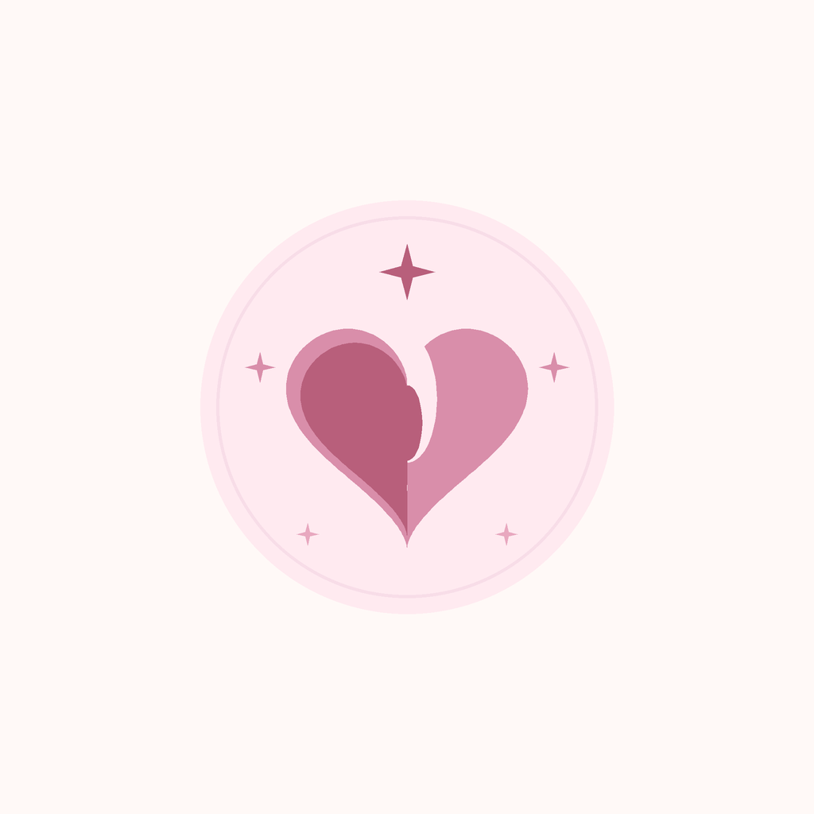
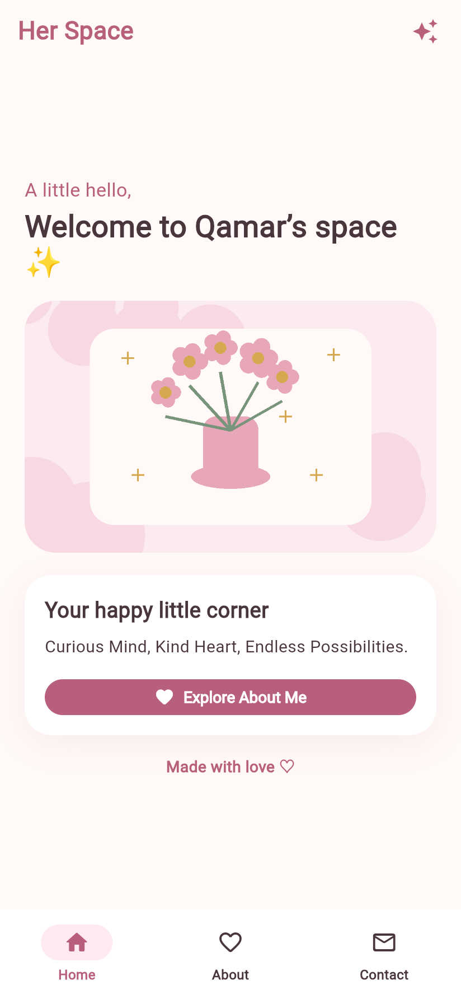
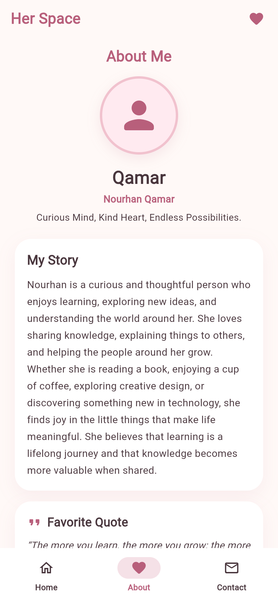
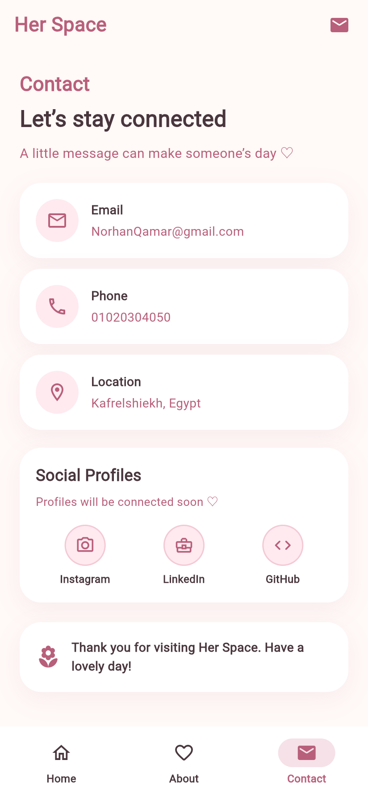

<div align="center">



# Her Space

**A little space for all things lovely.**

An elegant, feminine personal portfolio and digital sanctuary built with **Flutter** and **Material 3**.

[](https://flutter.dev)
[](https://dart.dev)
[](#design-system)
[](#technology-stack)
[](#quality-assurance--verification)
[](#academic-context)

[Explore Features](#features) • [Screenshots](#screenshots-gallery) • [Design System](#design-system) • [Getting Started](#installation--running) • [Presentation PDF](#academic-presentation)

</div>

---

## Project Overview

**Her Space** is a personalized mobile and web application created as an academic assignment for **AI 413 — Interactive Systems Design**. It serves as an intimate digital sanctuary and personal portfolio representing **Nourhan Qamar** (*Qamar*).

The application rejects generic dark themes and stark monochrome palettes in favor of a soft, welcoming, and feminine pastel aesthetic. Through thoughtful interaction design, seamless bottom navigation, and modular Flutter architecture, Her Space provides a calming environment to explore personal stories, creative design interests, knowledge sharing, and communication touchpoints.

### Core Destinations
1. **Home:** A welcoming entrance featuring a personalized greeting for Qamar, an embedded hero illustration card, and a direct call-to-action button to explore her background.
2. **About Me:** An inspiring personal profile featuring an avatar with soft border glow, full biographical narrative, highlighted quote card, and an interactive wrap of eight interest tags.
3. **Contact:** An organized communication hub with direct cards for Email, Phone, and Location, accompanied by friendly social profile placeholders and a persistent closing blessing.

---

## Screenshots Gallery

All screenshots below are captured directly from the live application running on Flutter Web and Android.

<div align="center">

| Home Screen | About Me Screen | Contact Screen |
| :---: | :---: | :---: |
|  |  |  |
| *Welcome greeting, hero illustration & CTA* | *Biography, favorite quote & 8 interest chips* | *Email, phone, location & social badges* |

</div>

> [!NOTE]
> **Privacy Consideration Before Public Publication:**
> The contact screen currently displays personal academic demo data (Email: `NorhanQamar@gmail.com`, Phone: `01020304050`, Location: `Kafrelshiekh, Egypt`). If publishing this repository to a public GitHub profile, review and sanitize `lib/data/profile_data.dart` if you wish to keep personal contact information private.

---

## Features

- **Personalized Home Experience:**
  - Dynamic display name greeting (`Welcome to Qamar’s space ✨`).
  - Bundled hero illustration with rounded corners and graceful error handling.
  - Inspirational tagline card with direct navigation button (`Explore About Me`).
- **Rich "About Me" Profile:**
  - Circular avatar frame with custom asset support (`assets/images/profile.png`) and fallback icon.
  - Displays both preferred display name (**Qamar**) and official name (**Nourhan Qamar**).
  - Detailed personal story focusing on lifelong learning and knowledge sharing.
  - Highlighted quote card: *"The more you learn, the more you grow; the more you share, the more you inspire."*
  - Eight curated interest tags: *Teaching & Explaining, Learning & Self-Development, Reading, Coffee, Fitness & Workouts, Creative Design, Programming, and Artificial Intelligence*.
- **Connected Contact Hub:**
  - Interactive contact cards with dedicated Material icons for Email, Phone, and Location.
  - Three non-interactive social profile badges (Instagram, LinkedIn, GitHub) clearly labeled as placeholders (*"Profiles will be connected soon ♡"*).
- **Navigation & State Management:**
  - Modern Material 3 `NavigationBar` with custom icon states and active pill indicators.
  - Zero-latency `IndexedStack` preserving individual scroll positions and widget states between tabs.
  - Programmatic navigation buttons linking Home → About and About → Contact.
- **Permanent Branded AppBar:**
  - Permanent `Her Space` title across all tabs in custom typography and color.
  - Distinct contextual action icons on each tab (`auto_awesome`, `favorite`, `mail`).
- **Native Platform Branding:**
  - Custom floral-heart master launcher icon configured via `flutter_launcher_icons`.
  - Android adaptive launcher icons with `#FFF9F7` background.
  - Android 12 native splash screen configured via `flutter_native_splash` with day and night styles strictly locked to `#FFF9F7`.
  - PWA favicon and manifest branding for web browsers.

---

## Design System

Her Space follows a strict **light, feminine, and pastel visual identity**. A fundamental design constraint across the entire project is **ABSOLUTELY NO BLACK WHATSOEVER**—stark `#000000`, dark charcoal, and cold dark gray tones are entirely excluded in favor of warm creams, soft blushes, and deep dusty rose tones.

### Color Palette

| Swatch | Color Name | Hex Code | Role in Application |
| :---: | :--- | :---: | :--- |
|  | **Warm Cream** | `#FFF9F7` | Primary background, scaffold surface, and splash screen background |
|  | **Pale Pink** | `#FFEAF0` | Chip backgrounds, icon circle containers, card accents, nav indicators |
|  | **Soft Blush** | `#F8DDE8` | Subtle border outlines, card contours, and secondary container fills |
|  | **Dusty Rose** | `#D98EAA` | Secondary accents, subtle subtitles, and decorative card borders |
|  | **Deep Soft Rose** | `#B85F7B` | Primary interactive buttons, AppBar title, active icons, card headings |
|  | **Light Rose** | `#E8A8BF` | Seed color for Material 3 color scheme and web theme bar |
|  | **Warm Plum Ink** | `#49363D` | High-contrast, gentle body typography replacing harsh black |

### Design Principles
- **Soft Geometry:** Generous border radii (18px on buttons, 20px on cards, 28px on hero illustrations).
- **Subtle Elevation:** Gentle translucent shadows (`alpha: 0.08–0.12`) avoiding dark muddy drop shadows.
- **Readable Contrast:** Deep rose and warm plum text achieving high legibility while remaining soft to the eyes.
- **Whitespace & Breathing Room:** Generous symmetric padding (`22px` horizontal, `28px` bottom) ensuring an unhurried, peaceful user flow.

---

## Technology Stack

The project is built on the official Flutter and Dart toolchain with zero third-party UI framework bloat:

- **Framework:** [Flutter 3.44.9](https://flutter.dev) (Channel stable)
- **Language:** [Dart 3.12.2](https://dart.dev)
- **UI Framework:** Material 3 (`useMaterial3: true`)
- **Navigation:** `IndexedStack` + `NavigationBar` (preserves state across destinations)
- **Theming:** Custom `AppTheme` with `ColorScheme.fromSeed` and explicit widget styling
- **Asset Management:** Bundled local images, adaptive branding icons, and native launch drawables
- **Code Quality:** `flutter_lints ^5.0.0` (zero warnings / strict lint rules enabled)
- **Build & Icon Tooling:**
  - `flutter_launcher_icons: ^0.14.4` (Android mipmap & Web PWA icon generation)
  - `flutter_native_splash: ^2.4.8` (Android native splash & 12+ splash styles)

---

## Project Structure

```text
her_space/
├── android/                             # Android native host project & Gradle configuration
│   ├── app/src/main/
│   │   ├── AndroidManifest.xml          # App label, permissions, orientation settings
│   │   └── res/                         # Native launcher icons (mipmaps) & splash styles
│   └── build.gradle.kts                 # Kotlin DSL Gradle configuration
├── assets/
│   ├── branding/                        # Master icon, splash screen & adaptive assets
│   │   ├── app_icon.png                 # 1024×1024 master floral heart icon
│   │   ├── app_icon_background.png      # Solid Warm Cream adaptive background
│   │   ├── app_icon_foreground.png      # Centered floral heart adaptive foreground
│   │   ├── splash_branding.png          # Bottom branding text for Android 12 splash
│   │   ├── splash_icon.png              # Centered emblem for pre-Android 12 splash
│   │   └── splash_icon_android12.png    # Circular safe-zone splash emblem
│   └── images/
│       └── home_illustration.png        # Bundled feminine hero illustration
├── lib/
│   ├── data/
│   │   └── profile_data.dart            # Single source of truth for personal data
│   ├── screens/
│   │   ├── home_page.dart               # Home screen destination & hero section
│   │   ├── about_page.dart              # About Me destination, bio & interest chips
│   │   ├── contact_page.dart            # Contact hub, touchpoint cards & social badges
│   │   └── main_navigation.dart         # IndexedStack wrapper & NavigationBar controller
│   ├── theme/
│   │   └── app_theme.dart               # Pastel color constants & Material 3 ThemeData
│   ├── widgets/
│   │   └── soft_card.dart               # Reusable rounded card with pastel border & shadow
│   └── main.dart                        # Application entry point (HerSpaceApp)
├── presentation/                        # Academic presentation source, PDF & assets
│   ├── assets/
│   │   ├── branding/                    # Presentation branding assets
│   │   ├── screenshots/                 # High-resolution screenshots (home, about, contact)
│   │   └── slides_preview/              # Rendered slide preview images (slide_1 to slide_7)
│   ├── config.json                      # Repository URL and presentation metadata
│   ├── generate_pdf.ps1                 # Automated script to generate presentation PDF
│   ├── index.html                       # 16:9 widescreen HTML presentation
│   ├── styles.css                       # Print & presentation stylesheet
│   ├── README.md                        # Presentation maintenance guide
│   └── Her_Space_Project_Presentation.pdf # Final 7-slide academic PDF presentation
├── test/
│   └── widget_test.dart                 # Automated navigation, data & branding tests
├── web/                                 # Web platform host, manifest & PWA icons
├── pubspec.yaml                         # Project dependencies and asset definitions
└── README.md                            # Project documentation & GitHub landing page
```

---

## Installation & Running

### Prerequisites
- [Flutter SDK](https://docs.flutter.dev/get-started/install) (version `>=3.3.0 <4.0.0`)
- [Android Studio](https://developer.android.com/studio) or [VS Code](https://code.visualstudio.com/) with Flutter extension
- Google Chrome (for web execution) or a connected Android device / emulator

### 1. Clone & Fetch Dependencies

In PowerShell or your terminal:

```powershell
git clone <REPOSITORY_URL>
cd her_space
flutter pub get
```

### 2. Run the Application

**Run on Google Chrome (Web):**
```powershell
flutter run -d chrome
```

**Run on a Connected Android Device:**
```powershell
# List connected devices
flutter devices

# Run on your target device (e.g. physical device ID or emulator)
flutter run
```

---

## Quality Assurance & Verification

The project includes an automated test suite and adheres to strict static analysis standards:

### Static Analysis
```powershell
flutter analyze
```
*Result: `No issues found!` (0 warnings, 0 lint errors).*

### Automated Widget Tests
```powershell
flutter test
```
*Result: All tests pass. Validates navigation flow, tab switching, personal profile values for Qamar, and permanent AppBar title.*

### Production Builds
```powershell
# Build web release
flutter build web

# Build debug APK for Android
flutter build apk --debug
```

---

## Academic Presentation

A 7-slide academic presentation in 16:9 landscape format has been prepared for university submission:

📄 **[View Presentation PDF](presentation/Her_Space_Project_Presentation.pdf)**

The presentation is fully reproducible and can be regenerated at any time using:

```powershell
powershell -ExecutionPolicy Bypass -File .\presentation\generate_pdf.ps1
```

To update the repository URL in the presentation prior to final submission:
1. Edit `presentation/config.json`.
2. Replace `"REPOSITORY_URL_TO_BE_ADDED"` with your actual repository URL.
3. Re-run `.\presentation\generate_pdf.ps1`.

---

## Academic Context

- **University:** Delta University for Science and Technology
- **Faculty:** Faculty of Artificial Intelligence
- **Course:** AI 413 — Interactive Systems Design
- **Academic Level:** Level 4, Semester 1
- **Student / Profile:** Nourhan Qamar (*Qamar*)
- **Project Name:** Her Space
- **Framework:** Flutter 3 with Material 3
- **Status:** Completed, verified, branded, and ready for evaluation.

---

<div align="center">
  <p>Made with love ♡ for <strong>Her Space</strong></p>
</div>
